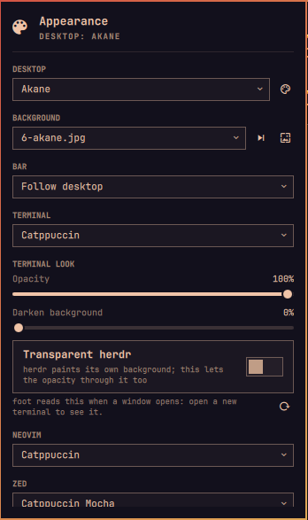

# Appearance UI — Omarchy bar widget

Pick the theme of each part of the desktop on its own, from one panel in the
Omarchy bar or from the Omarchy menu (`Style → Appearance`).




## What it controls

| Row        | Choices                              | How it applies                                   |
|------------|--------------------------------------|--------------------------------------------------|
| Desktop    | every installed Omarchy theme        | `omarchy theme set`                              |
| Background | images of the current theme          | `omarchy theme bg set`, next, or the switcher    |
| Bar        | *Follow desktop* or any Omarchy theme | managed `[bar]` block in `~/.config/omarchy/shell.toml` |
| Terminal   | *Follow desktop* or any Omarchy theme | Ghostty, Alacritty, Kitty and Foot includes      |
| Terminal look | opacity, darker background, transparent herdr (Foot only) | a second include in `~/.config/foot/foot.ini` |
| Neovim     | *Follow desktop* or any Omarchy theme | `~/.config/nvim/lua/plugins/theme.lua` symlink   |
| Zed        | themes Zed has (built-in + extensions) | `"theme"` in `~/.config/zed/settings.json`       |
| herdr      | themes herdr ships                   | `[theme] name` in `~/.config/herdr/config.toml`  |

Zed and herdr rows only appear when the app is installed, and they list the
app's own themes: there is no mapping from Omarchy theme names.

A pinned row keeps its theme when the desktop theme changes. Its files are
rendered by Omarchy's own templates (`omarchy-theme-set-templates`) into
`~/.local/state/omarchy-appearance/<row>/`, so a pinned Akane terminal looks
exactly like the Akane desktop terminal would. *Follow desktop* points the app
back at `~/.local/state/omarchy/current/theme/`.

## Terminal look

Below the Terminal row, three controls tune Foot on top of whatever theme it
shows:

- **Opacity** (50–100%) sets Foot's `alpha`. Only the background fades; text
  stays sharp, and Hyprland blurs what is behind the window.
- **Darken background** (0–60%) mixes the theme's background with black for
  more contrast. It is recomputed when the terminal or desktop theme changes,
  through a `theme-set` hook in `~/.config/omarchy/hooks/theme-set.d/`.
- **Transparent herdr** sets `alpha-mode=all`. herdr paints its own
  background, so without it the opacity stops at herdr's panes.

The values live in `~/.local/state/omarchy-appearance/look/`, and Foot reads
them through `include=~/.local/state/omarchy-appearance/look/foot.ini`, added
right after the theme include. The reset button removes the include, the
state and the hook.

## Install

```bash
omarchy plugin add https://github.com/piazzaAI/omarchy-appearance.git --enable
```

Enabling it adds the bar icon. To also reach the panel from the Omarchy menu,
press *Add to the Omarchy menu* at the bottom of the panel: it adds a
`Style → Appearance` row to `~/.config/omarchy/extensions/omarchy-menu.jsonc`,
and the same button removes it.

## Update

```bash
omarchy plugin update piazza.appearance
```

It shows the diff and fast-forwards to the latest commit. If the panel still
shows the old controls afterwards, run `omarchy restart shell`.

## Dependencies

- Omarchy Quattro (the Quickshell bar) and `jq`, which Omarchy ships.
- Optional: Zed and herdr. Their rows only appear when they are installed.
  The Zed row also needs `python3` (the Arch `python` package), used to read
  theme names and edit `settings.json`, which is JSON with comments.

No sudo or pkexec is required, and no file is touched until you pick
something in the panel.

## Keys

| Key            | Action                          |
|----------------|---------------------------------|
| `↑` / `↓`      | move between rows               |
| `Enter`        | open the row's picker           |
| `n`            | next background                 |
| `r`            | reload                          |
| middle click   | open Omarchy's theme switcher   |

## CLI

Everything the panel does is a call to the helper, which you can run directly:

```bash
./omarchy-appearance state
./omarchy-appearance set terminal catppuccin
./omarchy-appearance set nvim follow
./omarchy-appearance set bar tokyo-night
./omarchy-appearance set zed "Catppuccin Mocha"
./omarchy-appearance set herdr catppuccin
./omarchy-appearance set look opacity 85
./omarchy-appearance set look dim 20
./omarchy-appearance set look herdr on
./omarchy-appearance look reset
```

## Caveats

- Running Neovim instances pick up a change through LazyVim's hot reload; if
  one does not, reopen it.
- `omarchy refresh` of a terminal or Neovim config, or `omarchy reinstall`,
  restores the stock includes. Reapply the row from the panel afterwards.
- Foot only reads its config when a window opens, so the terminal look
  applies to new windows. Darken background does not reach herdr's own
  background, only Foot's.
- Setting a herdr theme turns its `auto_switch` off, otherwise herdr would
  replace the choice.

## Uninstall

```bash
~/.config/omarchy/plugins/piazza.appearance/omarchy-appearance set bar follow
~/.config/omarchy/plugins/piazza.appearance/omarchy-appearance set terminal follow
~/.config/omarchy/plugins/piazza.appearance/omarchy-appearance set nvim follow
~/.config/omarchy/plugins/piazza.appearance/omarchy-appearance look reset
~/.config/omarchy/plugins/piazza.appearance/omarchy-appearance menu remove
omarchy plugin remove piazza.appearance
```
